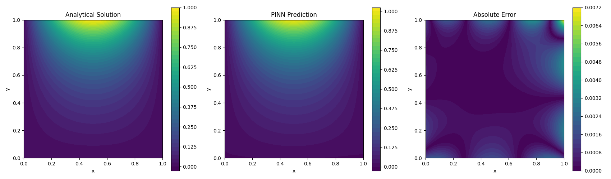
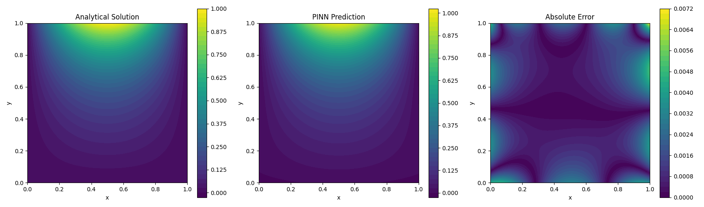
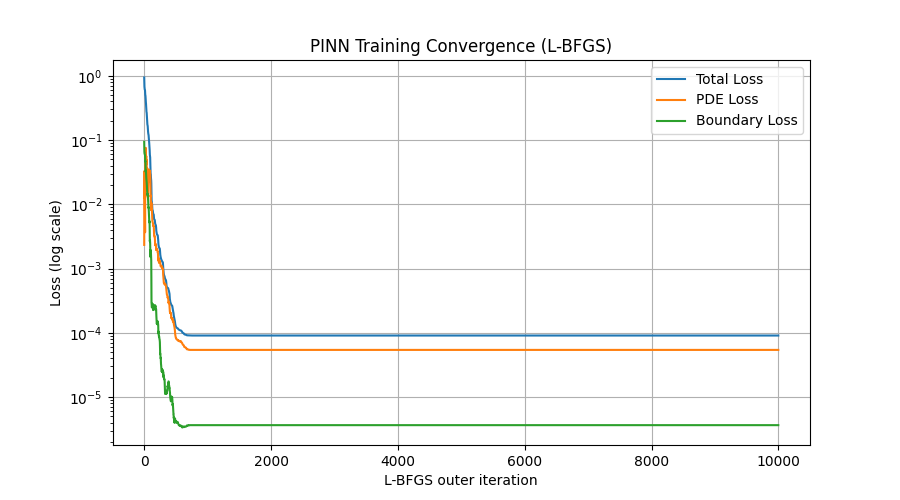
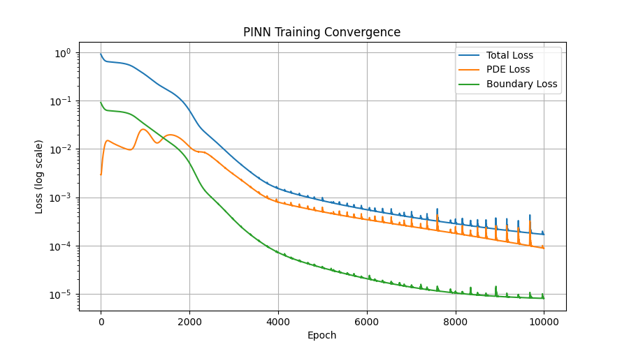

# PINN Laplace Optimisation Study
### Comparative Analysis of Adam and L-BFGS Optimisers for Physics-Informed Neural Networks

---

## Abstract

This project investigates the numerical solution of the two-dimensional Laplace equation using Physics-Informed Neural Networks (PINNs). The primary objective is to study how different optimisation algorithms influence the convergence behaviour and numerical accuracy of PINNs.

A fully connected neural network is implemented using PyTorch, with automatic differentiation employed to calculate the second-order spatial derivatives required by the governing partial differential equation.

Two optimisation algorithms, **Adam** and **Limited-memory Broyden–Fletcher–Goldfarb–Shanno (L-BFGS)**, are implemented and comparatively investigated.

The predicted solutions are validated against an analytical solution. Their performance is examined through training convergence curves, spatial error distributions, Mean Absolute Error (MAE), Maximum Absolute Error and Relative \(L^2\) Error.

The study focuses on understanding the relationship between optimisation mechanisms, training dynamics and numerical approximation accuracy.

---

## 1. Mathematical Formulation

The governing equation considered in this project is the two-dimensional Laplace equation:

$$
\boxed{
\Delta u =
\frac{\partial^2u}{\partial x^2}
+
\frac{\partial^2u}{\partial y^2}=0
}
$$

The computational domain is defined as:

$$
\Omega=[0,1]\times[0,1]
$$

### Boundary Conditions

The following Dirichlet boundary conditions are imposed:

$$
u(0,y)=0
$$

$$
u(1,y)=0
$$

$$
u(x,0)=0
$$

$$
u(x,1)=\sin(\pi x)
$$

### Analytical Solution

The exact analytical solution corresponding to the boundary-value problem is:

$$
\boxed{
u(x,y)=
\frac{\sinh(\pi y)}{\sinh(\pi)}
\sin(\pi x)
}
$$

This analytical expression is used as the reference solution for validating the PINN predictions.

---

## 2. Physics-Informed Neural Network Architecture

A fully connected feedforward neural network is implemented using PyTorch.

**Network architecture:**

- Input layer: 2 neurons, representing spatial coordinates \((x,y)\).
- Hidden layer 1: 32 neurons with Tanh activation.
- Hidden layer 2: 32 neurons with Tanh activation.
- Hidden layer 3: 32 neurons with Tanh activation.
- Output layer: 1 neuron, representing the approximate solution \(u_\theta(x,y)\).

The network approximates the unknown solution through:

$$
u_\theta(x,y)\approx u(x,y)
$$

where \(\theta\) denotes the trainable network parameters.

### Automatic Differentiation

PyTorch automatic differentiation is used to calculate the spatial derivatives:

$$
u_x=\frac{\partial u_\theta}{\partial x},
\qquad
u_y=\frac{\partial u_\theta}{\partial y}
$$

The second-order derivatives are subsequently obtained:

$$
u_{xx}=\frac{\partial^2u_\theta}{\partial x^2},
\qquad
u_{yy}=\frac{\partial^2u_\theta}{\partial y^2}
$$

The PDE residual is constructed as:

$$
\boxed{
r_\theta(x,y)=u_{xx}+u_{yy}
}
$$

The objective is to minimise this residual throughout the interior computational domain while satisfying the prescribed boundary conditions.

---

## 3. Physics-Informed Loss Function

The training objective consists of two components.

### PDE Residual Loss

For \(N_i\) interior collocation points:

$$
L_{\mathrm{PDE}}=
\frac{1}{N_i}
\sum_{j=1}^{N_i}
\left[
u_{xx}(x_j,y_j)+u_{yy}(x_j,y_j)
\right]^2
$$

### Boundary Condition Loss

For \(N_b\) boundary points:

$$
L_{\mathrm{BC}}=
\frac{1}{N_b}
\sum_{j=1}^{N_b}
\left[
u_\theta(X_j)-U_j
\right]^2
$$

### Total Loss Function

The combined optimisation objective is:

$$
\boxed{
L_{\mathrm{total}}=
L_{\mathrm{PDE}}+
\lambda_{\mathrm{BC}}L_{\mathrm{BC}}
}
$$

where the boundary loss weighting coefficient is:

$$
\lambda_{\mathrm{BC}}=10
$$

---

## 4. Optimisation Algorithms Investigated

The project examines two optimisation methods with fundamentally different update mechanisms.

### 4.1 Adam Optimiser

Adam is an adaptive gradient-based optimisation algorithm that uses exponentially weighted estimates of the first and second moments of gradients.

The first moment estimate is:

$$
m_t=\beta_1m_{t-1}+(1-\beta_1)g_t
$$

The second moment estimate is:

$$
v_t=\beta_2v_{t-1}+(1-\beta_2)g_t^2
$$

After bias correction:

$$
\widehat m_t=\frac{m_t}{1-\beta_1^t}
$$

$$
\widehat v_t=\frac{v_t}{1-\beta_2^t}
$$

The parameter update is:

$$
\boxed{
\theta_{t+1}=
\theta_t-
\eta
\frac{\widehat m_t}
{\sqrt{\widehat v_t}+\epsilon}
}
$$

Adam was investigated to examine how adaptive gradient scaling influences the training dynamics of a PINN.

### 4.2 L-BFGS Optimiser

L-BFGS is a limited-memory quasi-Newton optimisation algorithm.

Unlike first-order gradient methods, quasi-Newton methods incorporate approximate curvature information into the parameter update.

The Newton-type update is:

$$
\theta_{k+1}
=
\theta_k-H_k^{-1}\nabla L(\theta_k)
$$

where \(H_k\) represents the Hessian matrix.

L-BFGS approximates inverse-Hessian information using a limited history of parameter and gradient differences, avoiding the need to store the full Hessian.

Its conceptual update is:

$$
\boxed{
\theta_{k+1}=
\theta_k-\alpha_kB_k\nabla L(\theta_k)
}
$$

where \(B_k\) approximates inverse-Hessian information and \(\alpha_k\) denotes the step length.

A Strong-Wolfe line search is used in the implementation to determine suitable step lengths.

### Why Compare These Optimisers?

The comparison aims to investigate how adaptive first-order optimisation and quasi-Newton curvature-based optimisation behave when minimising a physics-informed objective involving second-order spatial derivatives.

---

## 5. Dataset and Experimental Configuration

The training dataset consists of 10,000 points distributed between the interior domain and its boundaries.

| Dataset component | Number of points |
|---|---:|
| Interior collocation points | 8,000 |
| Left boundary points | 500 |
| Right boundary points | 500 |
| Bottom boundary points | 500 |
| Top boundary points | 500 |
| **Total** | **10,000** |

The two optimisation experiments use the following configurations:

| Parameter | Adam | L-BFGS |
|---|---:|---:|
| Dataset size | 10,000 | 10,000 |
| Epochs / outer iterations | 10,000 | 10,000 |
| Learning-rate parameter | 0.001 | 1.0 |
| Boundary loss weight | 10 | 10 |
| Line search | Not used | Strong Wolfe |

**Note:** The learning-rate parameter of Adam and the step-size parameter of L-BFGS are not directly equivalent. L-BFGS may perform multiple closure evaluations during a single outer iteration.

---

## 6. Numerical Results and Visualisation

### 6.1 L-BFGS: Analytical Solution, PINN Prediction and Absolute Error

The following visualisation compares the analytical solution with the neural-network approximation and its corresponding absolute error distribution.

### 6.2 Adam: Analytical Solution, PINN Prediction and Absolute Error

### 6.3 L-BFGS Training Convergence

The L-BFGS training curve exhibits rapid initial reduction in the objective function, followed by an extended plateau.

### 6.4 Adam Training Convergence

The Adam training curve demonstrates gradual loss reduction, accompanied by recurring oscillations in the total, PDE and boundary losses.

---

## 7. Quantitative Validation

The predicted solutions are evaluated against the analytical solution using three numerical error metrics.

### Mean Absolute Error

$$
\boxed{
MAE=
\frac{1}{N}
\sum_{i=1}^{N}
|\hat u_i-u_i|
}
$$

### Maximum Absolute Error

$$
\boxed{
E_{\max}=
\max_{1\leq i\leq N}
|\hat u_i-u_i|
}
$$

### Relative \(L^2\) Error

$$
\boxed{
E_{L^2}=
\frac{
\|\hat{\mathbf u}-\mathbf u\|_2
}{
\|\mathbf u\|_2
}
}
$$

### Experimental Comparison

| Validation Metric | Adam (0.001) | L-BFGS (1.0) |
|---|---:|---:|
| Mean Absolute Error | 0.0010247309 | **0.00057760574** |
| Maximum Absolute Error | **0.0071077373** | 0.0077121293 |
| Relative \(L^2\) Error | 0.0048162495 | **0.0031214966** |

### Observations

The numerical results reveal the following:

1. L-BFGS achieved approximately **43.63% lower Mean Absolute Error** compared with Adam.
2. L-BFGS achieved approximately **35.20% lower Relative \(L^2\) Error**.
3. Adam produced a slightly lower Maximum Absolute Error.
4. Adam exhibited gradual convergence with recurring loss oscillations.
5. L-BFGS demonstrated rapid initial loss reduction followed by an extended plateau.

For the reported experimental configurations, L-BFGS achieved better average and relative global accuracy, whereas Adam retained a small advantage in maximum pointwise accuracy.

These observations are specific to the tested configurations and do not establish universal superiority of either algorithm.

---

## 8. Investigations and Questions Explored

The project developed through a series of mathematical and computational investigations:

- How can automatic differentiation construct a second-order differential operator?
- Why do PINN loss functions exhibit recurring oscillations during optimisation?
- How does learning-rate selection influence the stability of training?
- Does increasing the number of collocation points necessarily improve numerical accuracy?
- How do adaptive gradient methods differ from quasi-Newton methods?
- Why can L-BFGS stagnate under one step-size configuration but converge rapidly under another?
- Why must numerical solution accuracy be evaluated independently of training loss?

These questions motivated the successive experiments and comparative analysis.

---

## 9. Limitations and Future Work

The current study is an initial numerical investigation based on individual experimental runs.

Potential improvements include:

- Repeating experiments using multiple random seeds.
- Using identical boundary-point distributions and network initialisation for controlled optimiser comparisons.
- Comparing wall-clock training time and objective-function evaluations.
- Investigating the influence of collocation-point density.
- Examining hybrid Adam and L-BFGS optimisation strategies.
- Extending the framework to additional elliptic partial differential equations.

---

## 10. Technologies Used

- Python
- PyTorch
- NumPy
- Matplotlib
- Automatic Differentiation
- LaTeX

## Conclusion

This project presents a computational investigation of Physics-Informed Neural Networks for solving a two-dimensional elliptic partial differential equation.

By comparing Adam and L-BFGS, the study examines how different optimisation mechanisms influence training convergence and numerical approximation accuracy.

The availability of an analytical solution provides an independent mathematical reference for evaluating the network predictions. The combined analysis of convergence curves, spatial error distributions and quantitative validation metrics provides a more complete assessment than training loss alone.

The project brings together concepts from **partial differential equations, automatic differentiation, numerical optimisation and scientific machine learning**.

---

**Author:** Subham

**Project:** PINN Laplace Optimisation Study

**Research Areas:** Scientific Machine Learning · Numerical Analysis · Partial Differential Equations · Optimisation
